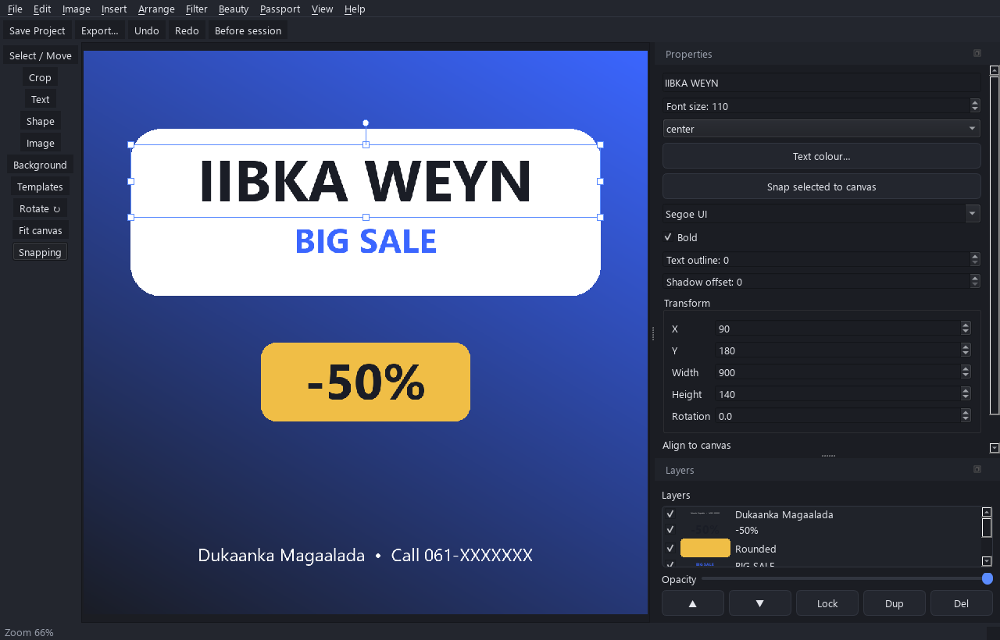
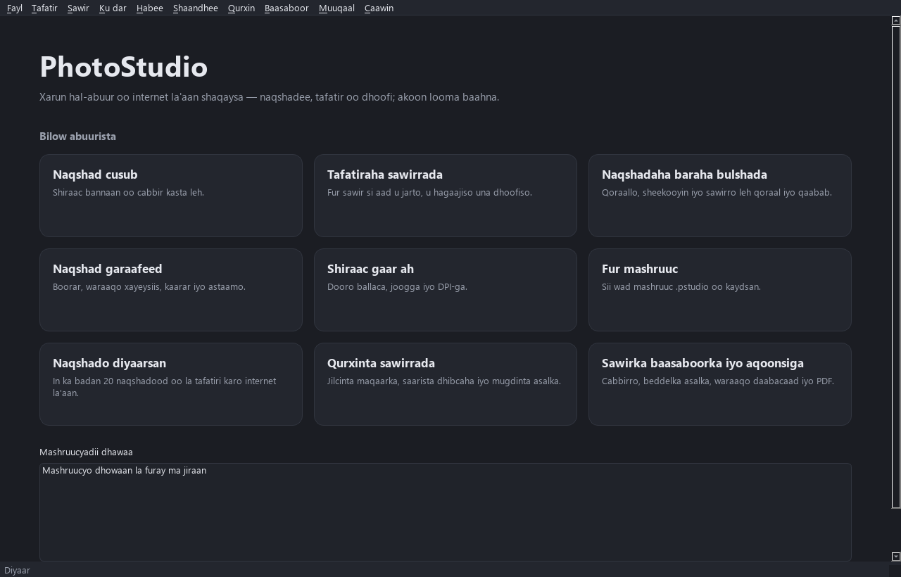

# PhotoStudio

**Offline-first photo & design studio for Windows 10/11 (x64).**

> **Version 1.2.0 — development build.**
> Interactive photo and design workflows run offline. Windows test installers are
> built by GitHub Actions; a public release requires maintainer approval.

Built with Python 3.11, PySide6 / Qt 6, NumPy, Pillow and OpenCV.

---

## Overview

PhotoStudio is a desktop application for editing photos and creating designs entirely on your own
computer — no account, no subscription, and no internet connection required. It uses a
non-destructive, layer-based document model so your edits stay re-editable, with full undo/redo and a
native `.pstudio` project format.

All editing tools, templates, project saving and exports remain free. Free PNG,
JPG and PDF exports include a small attribution near the bottom edge; editable
projects and the editing canvas do not. **File → Export Preview** shows the actual
export appearance. **File / Help → Remove Watermark** provides English payment
instructions and offline activation for a $10 USD, one-time, one-computer perpetual
watermark-removal license. No account, subscription or online activation is needed.

Payment: EVC Plus **0611354800**. After payment, send the confirmation SMS and
PhotoStudio Device ID to Mohamed at **mohamedqadar280@gmail.com** or WhatsApp
**+252611354800**. Mohamed verifies payment manually and supplies a signed key.
See [license issuance and activation](docs/LICENSING.md) for developer instructions.

## Features

### Implemented (working today)

- **Shared design engine** used by every workspace: raster image layers **plus editable text and
  vector shape objects** (rectangle, rounded, ellipse, triangle, line), each with offset, opacity,
  visibility, locking and blend mode.
- **New Design / Custom Canvas** — blank canvas at any size, add editable text and shapes.
- **Photo Editor** — open an image (JPG / PNG / WebP / TIFF / BMP), zoom/pan, crop (drag), rotate
  90° CW/CCW, flip H/V, resize; non-destructive **exposure, brightness, contrast, saturation,
  temperature, grayscale**; **Gaussian blur & sharpen** filters; **before/after** compare (`\`).
- **Social Media Designer** — real canvas presets (Instagram post/portrait/story, Facebook
  post/cover, YouTube thumbnail, TikTok, WhatsApp Status) using the shared engine.
- **Templates** — 22 original, fully-editable, offline starter designs across Business,
  Education, Restaurant and Events (incl. Somali small-business examples); every element is an
  editable layer; customize and export PNG/JPG.
- **Graphic Design** — preset canvases (A3/A4 poster, flyer, business card, banner, logo) at correct
  DPI, with text and shapes; **gradient** backgrounds, **SVG import**, **align to canvas** (6 ways),
  **snapping** helpers, layer **grouping** (move together), **reorder / duplicate / opacity / lock**,
  and editable **typography** (font size, colour, bold, alignment).
- **Interactive canvas** — click/Shift selection, marquee selection, direct dragging,
  eight resize handles, rotation handles, multi-object movement, snapping guides,
  arrow keys and Space+drag pan. Each completed gesture is one undo step; locked
  layers cannot be transformed.
- **Layers & properties** — background-generated thumbnails, mouse drag ordering,
  rename, visibility, locking, opacity, context menus and shared selection. Editable
  font family/size, bold, alignment, colour, outline/shadow, shape fills/strokes,
  gradients and numeric transforms are visible in the properties dock.
- Full **undo / redo**, including multi-object transforms and layer ordering.
- Save / open native **`.pstudio`** projects — text & shapes round-trip **editable**, never flattened.
- Export to **PNG** and **JPG**, matching the editor preview.
- **English / Somali** — switch in Settings while preserving the open document and history.
  Home includes recent projects; editor includes toolbars, properties, layers and context menus.
- **Stability** — unsaved-change prompts, atomic project saving, 30-second background
  autosave and startup/manual recovery. Large image operations run on workers and
  previews are bounded to 1600 pixels while exports remain full resolution.

- **Beauty Studio** — natural **skin smoothing** (edge-preserving), **portrait enhance**,
  approximate **background blur**, and **spot/blemish removal** (click to heal); all offline,
  identity-preserving, with before/after compare.

- **Passport & ID Photo** — example photo-size presets, **background replacement** (plain
  backgrounds), **face-alignment guides**, **10×15 cm & A4 print sheets** with accurate DPI and
  multiple-photo arrangement, and **PDF export**. *Sizes are layout examples only — not official
  biometric requirements; verify the exact spec with the relevant authority. No acceptance is
  guaranteed.*

### Current limits and future work

- Maximum image/canvas size: 40 megapixels. Crop/resize photo commands operate on
  the active raster layer; on-canvas transforms preserve editable objects.
- Background blur uses a feathered central ellipse, and background replacement is
  for plain backgrounds. They are approximate offline methods.
- Masks, adjustment layers, batch export, reusable components and optional licensed
  on-device AI remain future work. Somali translation is included; further review
  by native-speaking users is welcome.

See [ARCHITECTURE.md](ARCHITECTURE.md) and [development notes](docs/DEVELOPMENT.md).

## Screenshots

Source build, captured with the real Qt application:




## Download

The latest tested installer and checksum are available as **PhotoStudio-Setup**
artifacts on the [Windows Build runs](https://github.com/Mohamed-Qadar/photo/actions/workflows/windows-build.yml).
The **PhotoStudio-QA** artifact includes source and packaged workflow screenshots.
GitHub requires signing in to download Actions artifacts.

Approved pre-built Windows releases are published on the
[**Releases**](https://github.com/Mohamed-Qadar/photo/releases) page when available:

- `PhotoStudio-Setup.exe` — installer (no Python required)
- `PhotoStudio-Setup.exe.sha256` — checksum to verify the download

Verify the download before running:

```powershell
Get-FileHash PhotoStudio-Setup.exe -Algorithm SHA256
```

> Releases during development are published as **pre-releases** and are for testing only.

## Installation (end users)

1. Download `PhotoStudio-Setup.exe` from the Releases page.
2. Run it (a per-user install — no administrator rights needed).
3. Launch PhotoStudio from the Start Menu (or the optional desktop shortcut).

To uninstall, use **Settings → Apps** or the Start Menu uninstaller. Your saved `.pstudio` projects
are **not** deleted on uninstall.

## System requirements

- Windows 10 or 11, 64-bit (x64)
- ~400 MB free disk space for the installed application
- No separate Python installation required for the packaged app

## Run from source (development)

The project runs directly from source — development mode is fully supported.

Easiest: run **`run.bat`**. It checks for Python, creates a virtual environment, installs
dependencies, and launches the app, with clear error messages if anything fails.

Manual equivalent:

```powershell
python -m venv .venv
.\.venv\Scripts\python.exe -m pip install -r requirements.txt
.\.venv\Scripts\python.exe run.py
```

Requires Python 3.11+ on PATH.

## Testing

Run **`test.bat`** (installs `dev-requirements.txt`, then runs pytest with an offscreen Qt platform),
or manually:

```powershell
.\.venv\Scripts\python.exe -m pip install -r dev-requirements.txt
.\.venv\Scripts\python.exe -m pytest
```

The `core` and `imaging` packages are Qt-free; a test enforces that boundary.
Qt interaction tests cover crop, drag, resize, rotation, selection, snapping and layer ordering.
Additional workflows validate localization, recovery, workers and export accuracy.

Run the GUI workflow check with `python tool/smoke_test.py`. The packaged application
supports `PhotoStudio.exe --smoke-test --smoke-output <folder>` for CI verification.

## Building the Windows installer (maintainers)

Handled automatically by GitHub Actions (`.github/workflows/windows-build.yml`) on a Windows runner:
tests → source GUI workflows → PyInstaller → packaged GUI workflows → Inno Setup → SHA-256 → uploaded artifacts. Pushing a `v*` tag additionally
publishes a GitHub pre-release. Local build:

```powershell
pip install pyinstaller
pyinstaller packaging\photostudio.spec --noconfirm
iscc installer\photostudio.iss
```

## Developer

**Developed by Eng. Mohamed Ibrahim Abdi — Computer Engineer, specializing in Natural Language
Processing and Computer Vision.**

- Contact: [mohamedqadar280@gmail.com](mailto:mohamedqadar280@gmail.com)
- GitHub: [https://github.com/Mohamed-Qadar/photo](https://github.com/Mohamed-Qadar/photo)
- Version: 1.2.0

## Version history

- **1.2.0** (in development) — Interactive canvas, richer layers/properties, English/Somali UI,
  autosave/recovery, atomic persistence and background previews. See docs/DEVELOPMENT.md. Milestone F: Passport & ID — example size presets, background
  replacement, face guides, 10×15/A4 print sheets with accurate DPI & multi-photo layout, PDF export
  (sizes are examples, not official specs). Milestone E: Beauty Studio — skin smoothing (bilateral), portrait
  enhance, background blur, click-to-heal spot removal (OpenCV, offline). Milestone D:
  align-to-canvas, snapping, grouping + group-move, layer
  reorder/duplicate/opacity/lock, editable typography, SVG import (QtSvg), richer Layers panel,
  Arrange menu. Milestone C: 22 editable offline templates (Business / Education /
  Restaurant / Events, incl. Somali examples), gradient backgrounds, Templates picker. Milestone B:
  extended non-destructive adjustments (exposure,
  saturation, temperature, grayscale) with a Reset, Gaussian blur & sharpen filters, and
  before/after compare. Milestone A: shared design engine with editable **text & shape**
  object layers (render, composite, `.pstudio` persistence, undoable add/move/edit/lock); redesigned
  home screen (hero + tiles, no empty panels / dark rectangles); Social Media & Graphic Design
  workspaces backed by the shared engine with real canvas presets; Insert menu (text/shapes);
  docks hidden on the home screen. 71 baseline automated tests.
- **1.1.1** — Project identity & Windows distribution setup: app version/attribution, original app
  icon, PyInstaller spec with EXE metadata, Inno Setup installer, GitHub Actions Windows build
  pipeline (tests → build → installer → checksum → artifact, pre-release on tags), full README.
  Core Phase 1 editing (open/crop/rotate/adjust/undo-redo/save/export) implemented and tested.

## License & attribution notes

No third-party branded assets, proprietary UI, or AI models are bundled. Any future on-device model
will be added only after its redistribution license is documented. Inspiration from other tools is
conceptual only; all code and assets here are original.
